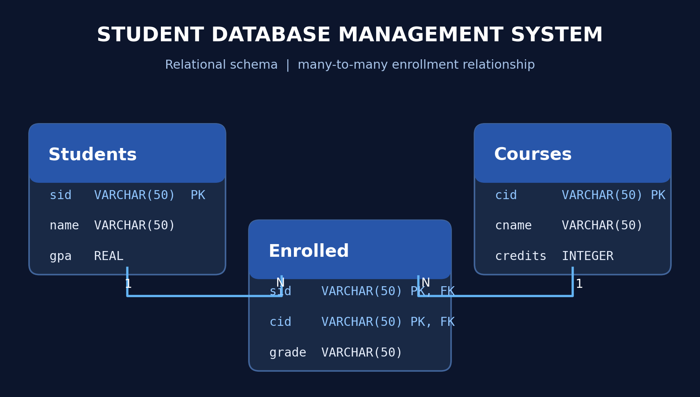

<div align="center">

# 🎓 Student Database Management System

**SQL · Relational Database Design · Data Integrity · Joins**

A relational database for managing students, courses, and enrollment records.

</div>

## 🗂️ Database Schema



The project contains three related tables:

| Table | Purpose | Key(s) |
|---|---|---|
| `Students` | Student identifiers, names, GPAs | `sid` (primary key) |
| `Courses` | Course identifiers, names, credits | `cid` (primary key) |
| `Enrolled` | Student-course registrations and grades | (`sid`, `cid`) composite primary key; both are foreign keys |

The `Enrolled` table resolves the many-to-many relationship between students and courses. Its composite key prevents duplicate enrollments for the same student and course.

## ✨ Project Features

- Defined primary keys, foreign keys, and non-null constraints.
- Created and populated tables using SQL.
- Modeled course registrations and grades with a junction table.
- Added example SQL queries using joins, aggregation, and grouping.

## 📊 Included Sample Records

The original SQL script successfully loads **53 students**, **10 courses**, and **159 enrollment records** into SQLite. These are sample records, not real student data.

## 📁 Repository Structure

```text
student-database-management/
├── assets/
│   └── er_diagram.png
├── sql/
│   ├── schema_and_seed.sql
│   └── example_queries.sql
├── .gitignore
└── README.md
```

## 🚀 Run Locally

**Option 1 — SQLite CLI** (requires SQLite installed):

```bash
sqlite3 students.db < sql/schema_and_seed.sql
sqlite3 -header -column students.db < sql/example_queries.sql
```

**Option 2 — Python standard library** (no third-party packages):

```python
import sqlite3
from pathlib import Path

conn = sqlite3.connect(':memory:')
conn.execute('PRAGMA foreign_keys = ON')
conn.executescript(Path('sql/schema_and_seed.sql').read_text())
print(conn.execute('SELECT COUNT(*) FROM Students').fetchone())
```

## 🔎 Example SQL Query

```sql
SELECT s.name, c.cname AS course, e.grade
FROM Students AS s
JOIN Enrolled AS e ON s.sid = e.sid
JOIN Courses AS c ON e.cid = c.cid
ORDER BY s.name, c.cname;
```

See [`sql/example_queries.sql`](sql/example_queries.sql) for additional queries.

## 🛠️ Technologies & Concepts

 

Relational schema design · Primary/foreign keys · Composite keys · SQL joins · Aggregate functions

## 👩🏾‍💻 Author

**Khaydie Ramos** — [GitHub](https://github.com/khaydieramos)

> Note: The schema and sample records come from the original project SQL file. The ER diagram and demonstration queries were prepared for this portfolio repository.
